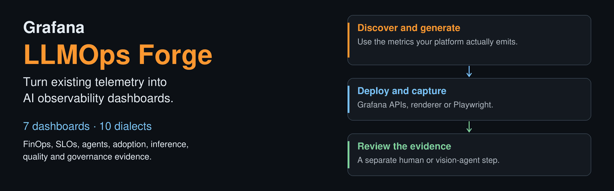
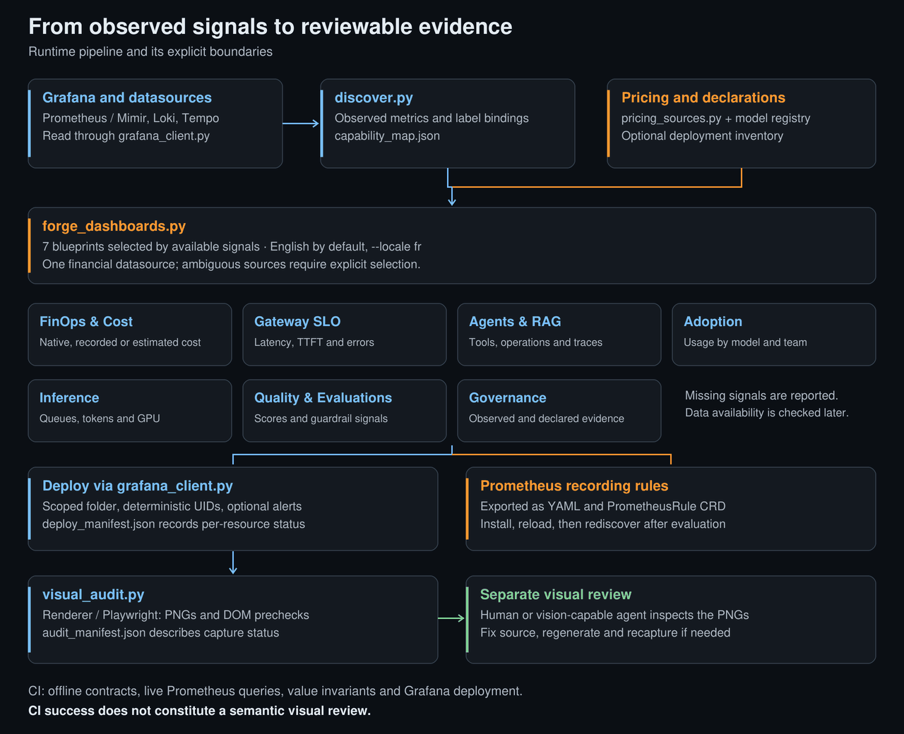
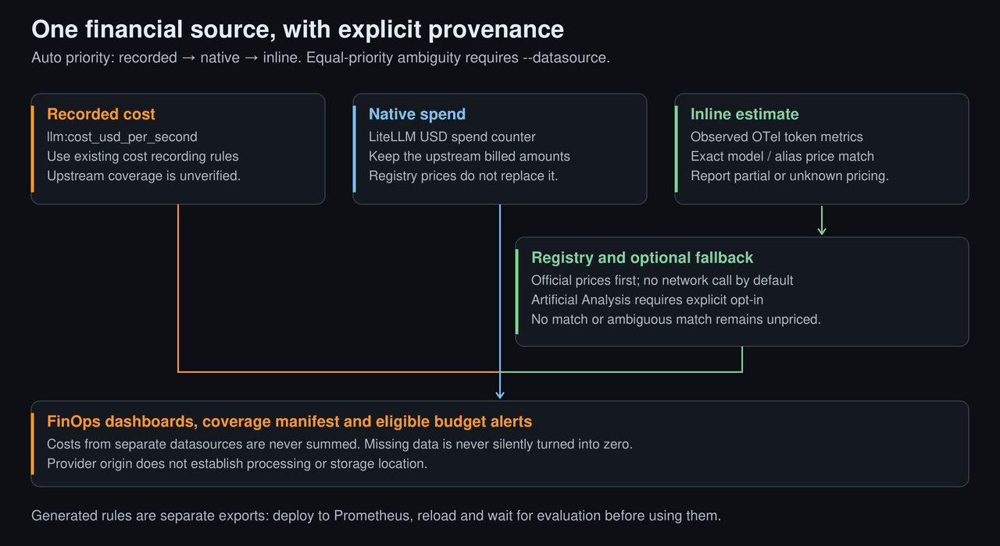
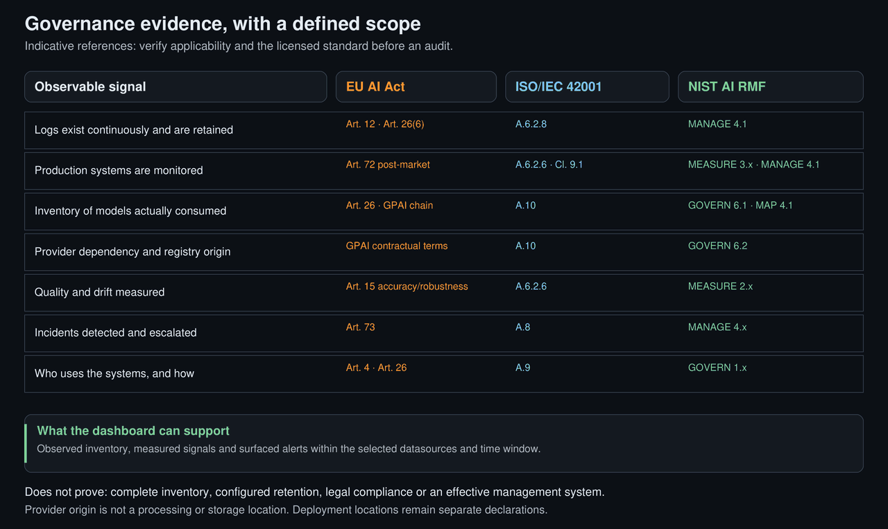
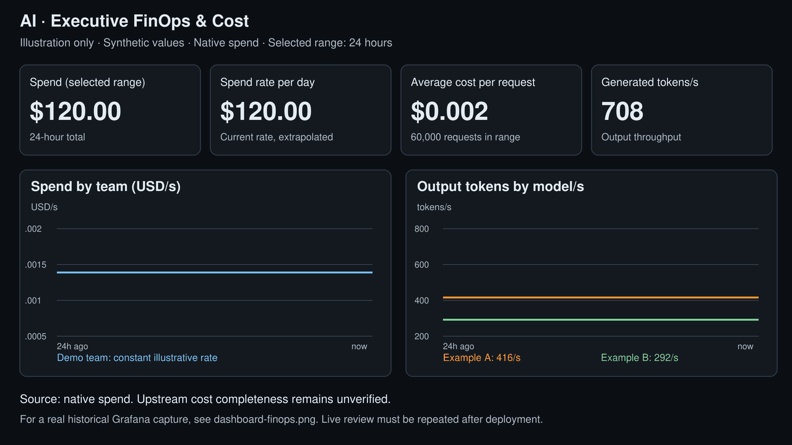
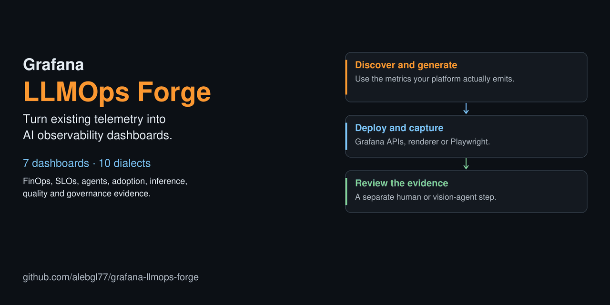

# Animated visual guides

These six GIFs explain the repository's workflows. Text and numbers stay fixed;
motion identifies the current step, path or correspondence. They are illustrations,
not recordings of a running instance. Each animation loops and has a static SVG
alternative. Where the viewer supports it, reduced-motion preferences select the SVG.

## Discover, deploy, review

<picture><source media="(prefers-reduced-motion: reduce)" srcset="assets/banner.svg"></picture>

[GIF](assets/banner.gif) · [Static SVG](assets/banner.svg)

## Architecture

Discovery and pricing are separate inputs. Generated dashboards and rule exports
have distinct destinations; capture is followed by a separate visual review.

<picture><source media="(prefers-reduced-motion: reduce)" srcset="assets/architecture.svg"></picture>

[GIF](assets/architecture.gif) · [Static SVG](assets/architecture.svg)

## Financial source selection

The animation shows recorded, native and inline paths one after another in priority
order. These are alternatives: it never represents summing the three sources.

<picture><source media="(prefers-reduced-motion: reduce)" srcset="assets/pricing-flow.svg"></picture>

[GIF](assets/pricing-flow.gif) · [Static SVG](assets/pricing-flow.svg)

## Governance crosswalk

Each highlighted row maps one observable signal to three indicative frameworks.
There is no transfer between frameworks and no automatic certification.

<picture><source media="(prefers-reduced-motion: reduce)" srcset="assets/governance-crosswalk.svg"></picture>

[GIF](assets/governance-crosswalk.gif) · [Static SVG](assets/governance-crosswalk.svg)

## FinOps illustration

Cursors move through fixed synthetic time series. The values do not change and
do not claim live updates. The historical Grafana capture remains available separately.

<picture><source media="(prefers-reduced-motion: reduce)" srcset="assets/dashboard-finops.svg"></picture>

[GIF](assets/dashboard-finops.gif) · [Static SVG](assets/dashboard-finops.svg) · [Historical capture](assets/dashboard-finops.png)

## Shareable landscape version

The 1280 × 640 GIF follows the same three steps as the banner. Use the static PNG
for the repository's social-preview setting; use the GIF where animation is supported.

<picture><source media="(prefers-reduced-motion: reduce)" srcset="assets/social-preview.svg"></picture>

[GIF](assets/social-preview.gif) · [Static SVG](assets/social-preview.svg) · [Static PNG](assets/social-preview.png)

To rebuild or verify these exports, follow [the contributor guide](../CONTRIBUTING.md#documentation-visuals).
